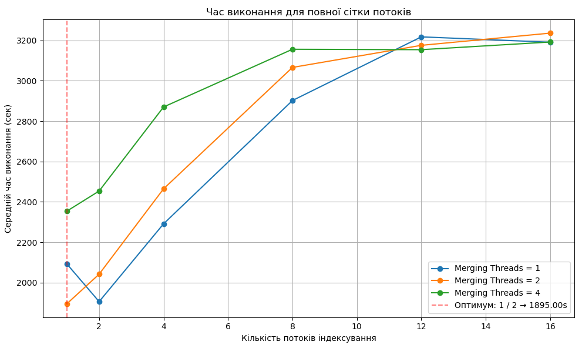
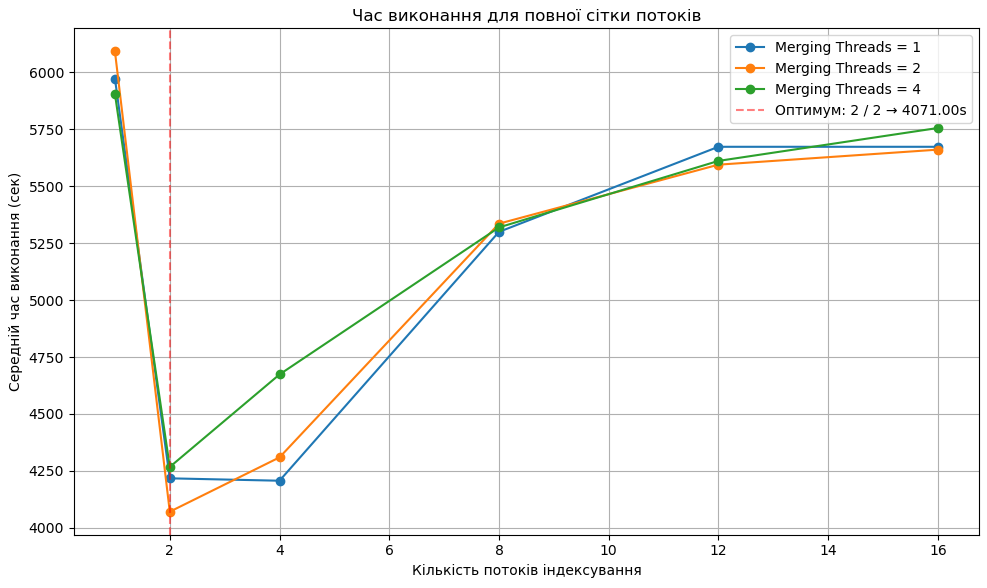
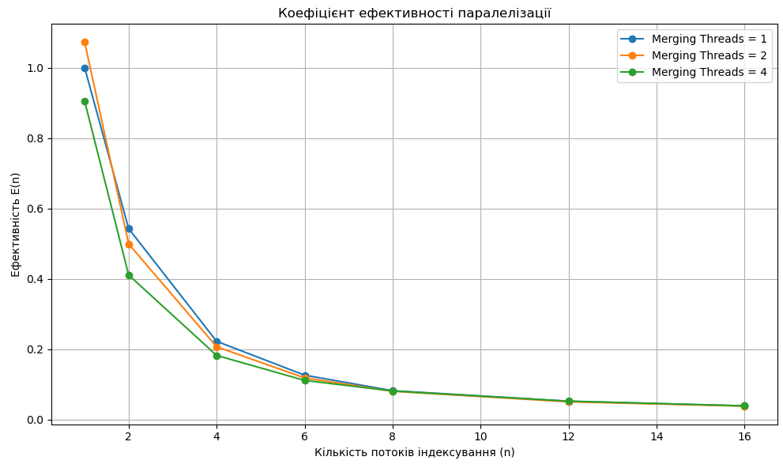
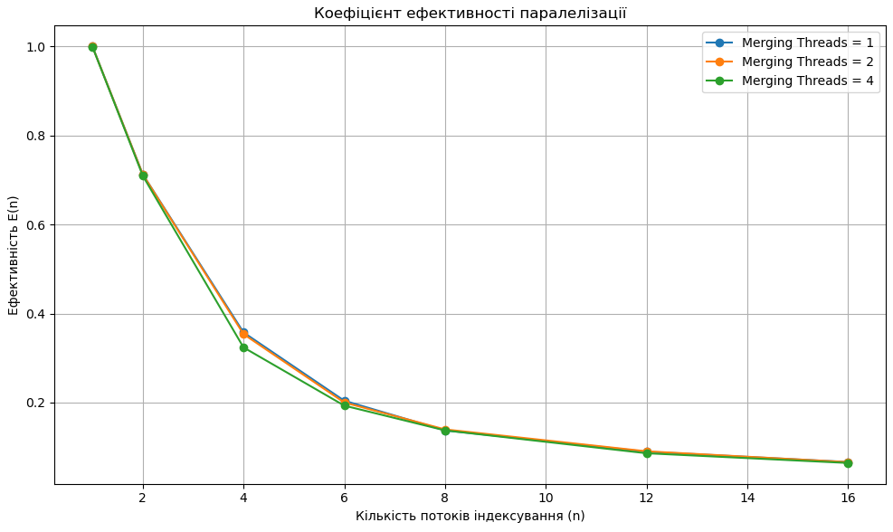
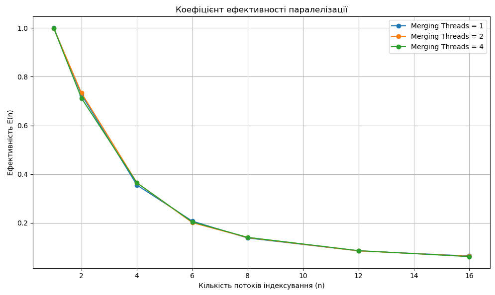
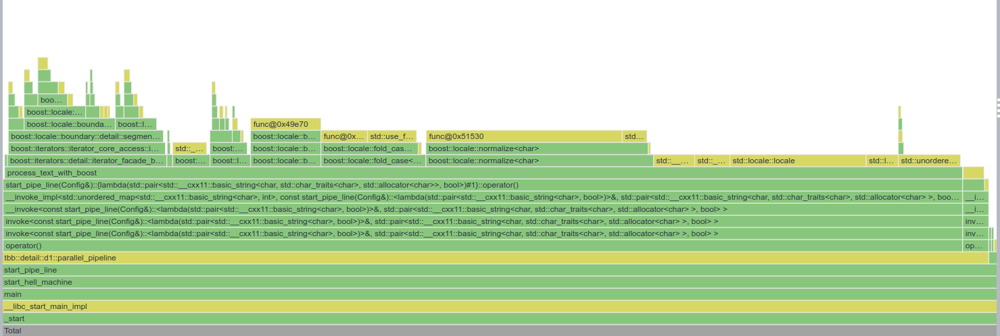
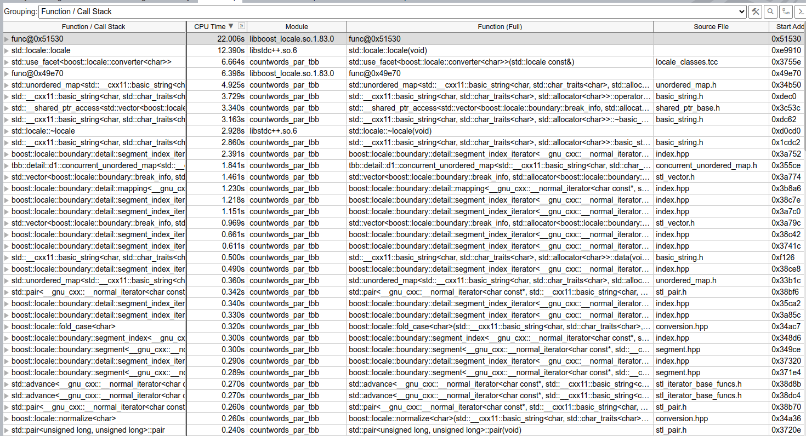

# Lab work 10: 

Authors (
team): [Valihurskyi Anton](https://github.com/BlueSkyAndSomeCurses), [Kravchuk Yevhenii](https://github.com/eugenekravchuk), [Kuzma Volodymyr](https://github.com/Kuzmarg)  
Additional: 1

## Prerequisites

- g++
- cmake
- make
- python3
- LibArchive (`sudo apt install libarchive-dev`)
- boost (`sudo apt install libboost-all-dev`)
- ICU (`sudo apt install libicu-dev`)
- Abseil (`sudo apt install libabsl-dev`)

### Compilation

```
./compile.sh -o
```

```shell
mkdir build && cd build
cmake ..
make all
```

### Installation

```
git clone https://github.com/ucu-cs/lab10-words-count-high-level-tools-valihurskyi_kuzma_kravchuk
```

### Usage

```
python3 ./python_scripts/runner.py <num_of_iterations (>1)> <flush (0|1)>
```

# Report

## Сomputers

**Комп'ютер 1:**

- Процесор: Intel i7-12650H
    - Physical cores: 10
    - Logical cores: 16
    - P-cores: 6
    - E-cores: 4
- RAM: DDR5 4800
- Storage: SAMSUNG MZVL21T0HCLR-00B07
    - Sequential Read 7000 MB/s
    - Sequential Write 5100 MB/s'

**Комп'ютер 2:**

- Процесор: AMD Ryzen 7 4800H
    - Physical cores: 8
    - Logical cores: 16
    - P-cores: 8
    - E-cores: 0
- RAM: DDR4 3200
- Storage: INTEL SSDPEKNW512G8L (C04C)
    - Sequential Read 1646 MB/s
    - Sequential Write 826 MB/s

**Комп'ютер 3:**

- Процесор apple M4 pro
    - efficiency cores: 4
    - performance cores: 8
- RAM: DDR5 24gb
- Storage: not exposed

**Комп'ютер 4**

- процесор amd ryzen 2600x
- RAM: DDR3 2333 Mhz 16gb
- storage: ssd read 501.6 MB/sec (estimated with `hdparm`)
- hdd: read 91 MB/sec

## Main part
Running current implementation on `gutenberg_ascii_en_part.iso`:
```
Total=85213
Finding=0
Reading=1126
Writing=862
```

Running lab9 implementation on `gutenberg_ascii_en_part.iso`:
```
Total=138257  
Finding=427  
Reading=2290  
Writing=1727 
```

Running lab8 implementation on `gutenberg_ascii_en_part.iso`:
```
Total=120768
Finding=215
Reading=81338
Writing=1584
```

Counting words of whole library took total 2086167 ms and for writing 29402 on comp 1.
Resulting files can be
found [here](https://drive.google.com/drive/folders/14OzWqQcOhiVb1T6qrZyrJUGGfqEF-YMe?usp=sharing).

## Time on different thread count
To compare the performance, we ran `python_scripts/running_time.py` on a smaller dataset (gutenberg_ascii_en_part.iso, folder `/7/7`).

Current result:  


Lab 9 results:  


Lab 8 results:  


### Comparison of Three Execution Time Graphs

These three graphs show the **average execution time** of the parallel program with different combinations of:
- `indexing_threads` — threads for indexing
- `merging_threads` — threads for merging results

---

### Implementation Context

- **First graph** — implementation `countwords_par_tbb`, based on `oneapi::tbb::parallel_pipeline`, fully restructures the logic from previous versions into a **multi-stage pipeline**:
  - **File discovery** (`fs::recursive_directory_iterator`)
  - **Reading content** from files or archives
  - **Text processing**: word splitting via `boost::locale::boundary::ssegment_index`
  - **Merging results** into `tbb::concurrent_unordered_map<std::string, int>`

- **Second graph** — implementation `countwords_par_proftools`, a modified version of previous practical work using **third-party thread-safe structures**:
  - `boost::lockfree::queue` — lock-free queues for transferring files, content, and dictionaries
  - `tbb::concurrent_unordered_map` — concurrent global word counter

- **Third graph** — implementation `countwords_par`, using **custom implementations** of:
  - thread-safe queues
  - concurrent hash maps
  - a custom thread pool

---

### Comparison Table

| Implementation                | Tools Used                          | Best Configuration     | Time (sec) | Comment                        |
|-------------------------------|--------------------------------------|-------------------------|------------|---------------------------------|
| **countwords_par_proftools**  | TBB + Boost (lock-free queue + map) | 2 / 2                   | 4071       | High resource consumption      |
| **countwords_par**            | Custom queues, maps, thread pool     | 4 / 1                   | 2213       | Very good optimization         |
| **countwords_par_tbb**        | `tbb::parallel_pipeline`             | 1 / 2                   | **1895**   | Best performance               |

---

### Analysis

#### 1. **Absolute Execution Time**
- `countwords_par_tbb` is the **fastest**, reaching minimum time due to pipeline architecture and reduced contention.
- `countwords_par` (custom) also shows strong performance due to efficient queue/thread management.
- `countwords_par_proftools` is slower due to third-party overhead.

#### 2. **Indexing Thread Count**
- In `countwords_par_proftools`, the best result is at **2 indexing threads**.
- In `countwords_par`, scaling is effective up to **4 indexing threads**.
- In `countwords_par_tbb`, optimal result is achieved with **just 1 indexing thread**, indicating a well-balanced pipeline.

#### 3. **Merging Threads**
- `countwords_par_proftools`: 2 merging threads give the best result.
- `countwords_par`: most efficient with 1 merging thread, suggesting optimized merging.
- `countwords_par_tbb`: best with **2 merging threads**, balancing minimal indexing with concurrent aggregation.

---

### Conclusions

1. **`countwords_par_tbb` shows the best performance**, achieving the lowest time due to its `tbb::parallel_pipeline` architecture, minimizing thread contention.
2. **`countwords_par` shows good scalability** and efficiency via full control over threads and data structures.
3. **`countwords_par_proftools` (TBB+Boost)** enables easier integration of external tools but incurs higher overhead and worse performance.
4. All three implementations demonstrate a typical multithreading behavior: improved performance up to a point, then reduced efficiency as thread count exceeds the optimal threshold.


## Efficiency

We've built a graph of efficiency of parallelization (`gutenberg_ascii_en_part.iso`, folder `/7/7`) :



To investigate the parallelization efficiency, we chose options for the number
of indexing threads (from 1 to 16) and merge threads (1, 2, 4).
Such parameters allow us to cover the entire available range of
hardware parallelism of the processor (16 cores), while not creating excessive overload on the less costly phase of dictionary merging.

The results demonstrate the classical behavior according to Amdahl's law: as the number of threads grows, efficiency decreases due to competition for resources and restrictions by unparallelized code sections.

We can compare with two previous efficiency graphs:  

Lab9:  


Lab 8:



### Efficiency Trends

| Threads (`n`) | TBB Efficiency     | Proftools Efficiency | Custom Efficiency   |
|---------------|---------------------|-----------------------|----------------------|
| 1             | ~1.0–1.05           | ~1.0                  | 1.0                  |
| 2             | ~0.55               | ~0.7                  | ~0.75                |
| 4             | ~0.25               | ~0.35                 | ~0.45                |
| 8             | ~0.10               | ~0.15                 | ~0.2                 |
| 16            | ~0.05               | ~0.08                 | ~0.12                |

### Conclusions

1. **Custom implementation** outperforms others in **scalability** and maintains the highest efficiency up to 8–12 threads.
2. **Proftools (Boost + TBB)** sits in the middle — easier to implement than custom, more scalable than TBB pipeline alone, but still limited by third-party overhead.
3. **TBB pipeline**, while fastest at low thread counts, degrades quickly in parallel efficiency due to likely stage imbalance or bottlenecks.


## Vtune



We have used `vtune` to analyze places in our code that take up most of our cycles. 

  

Based on the VTune analysis, we can clearly see that the main bottleneck in our countwords_par_tbb implementation is text processing — especially boost::locale::fold_case, normalize, and ssegment_index. These functions alone consume more than 50% of the total execution time. Another significant portion of time goes into creating and copying std::locale objects, which seems to happen too frequently, likely inside tight loops or pipeline stages

# Additional tasks