# Lab work 5: Parallel integral with thread pool
Authors (team): [Valihurskyi Anton](https://github.com/BlueSkyAndSomeCurses) [Oleh Shtohryn](https://github.com/lalkaman1981) [Vasyl Tarnavskyi](https://github.com/TarnMaVas)

## Prerequisites

gcc clang cmake make ninja python3 boost facebook::folly (for the first additional task)

### Compilation

Firstly, install all the dependencies and clone `tomlplusplus` repository.

```sh
$ mkdir build && cd build
$ cmake ..
$ make all || ninja
```

### Installation

```shell
$ git clone https://github.com/marzer/tomlplusplus.git --depth=1
$ python -m venv .env
$ source .env/bin/activate
$ pip install -r requirements.txt
```
### Usage

Binary of integral runner wil be named `thread_pool`

```sh
$ ./build/thread_pool <func_number> <path/to/config/file> <number_of_threads> <number_of_jobs_per_thread>
```

```sh
$ ./runner_integral_parallel.py <number_of_calls> <number_of_threads> <number_of_jobs_per_thread>
```

# Additional tasks
- Usage of `facebook::folly` tasks executor
- Implementation of work stealing tread pool and comparison to standard approach
- Estimamted portion of parallelized code with Amdal's law and linear regression.

# Report

## Основне завдання
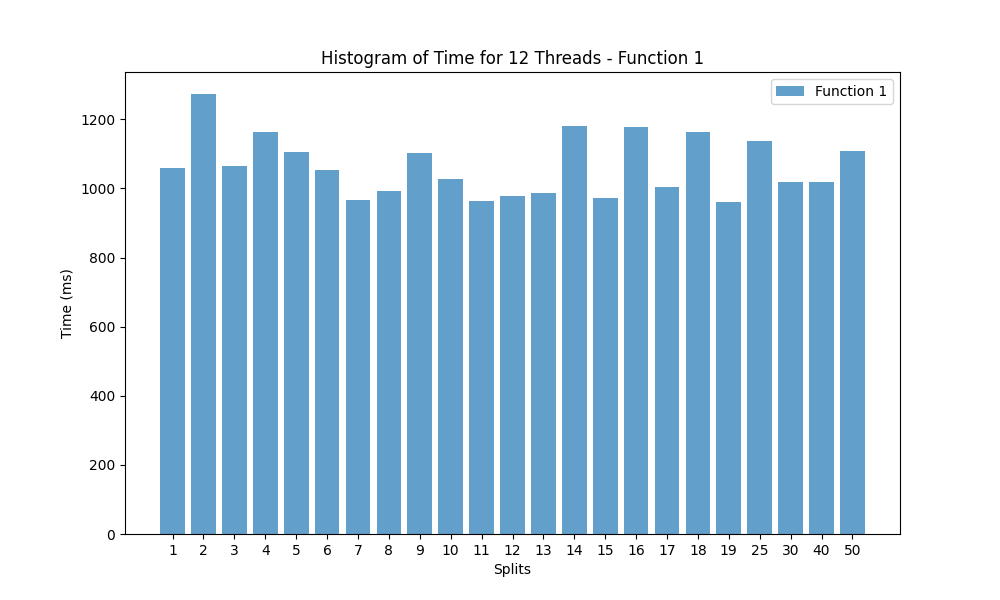
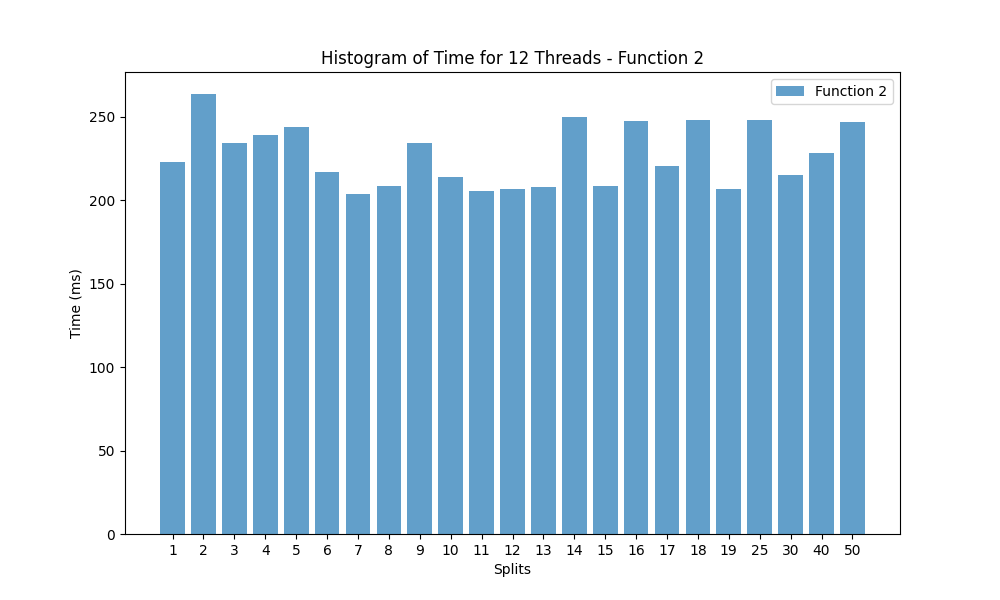
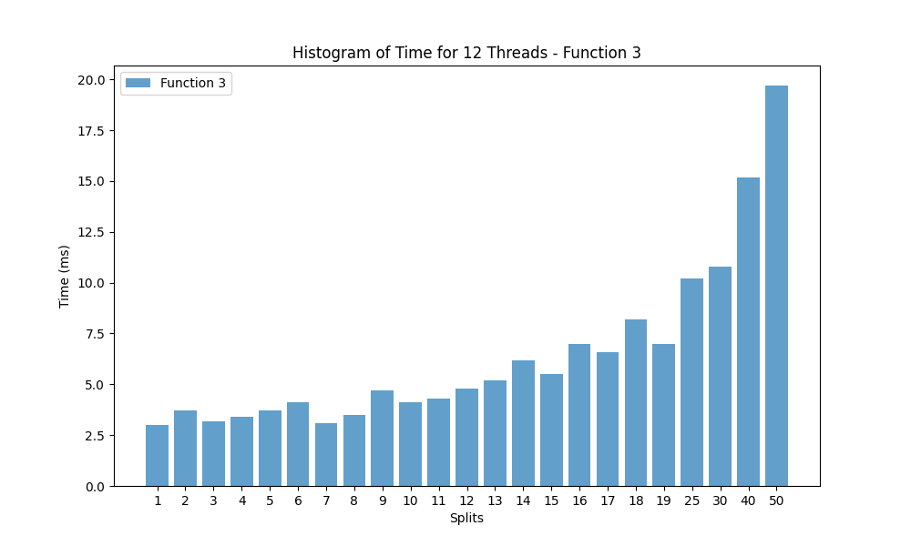

Вище представлено гістограми середнього часу роботи 10 ітерацій на 12 потоках за різної кількості розбиттів по осі y - як і у практичній роботі, присвяченій багатопоточній черзі, функції 1 та 2 показали доволі подібні результати, функція 3 від них суттєво відрізняється. Цього разу оптимальна кількість розбиттів трохи збільшилася - тепер вона дорівнює 7, минулої практичної найкращим значенням було 6. Відповідно, за нашої реалізації 100\*100 точок діляться на 12\*7 регіонів, отже оптимальна кількіть точок у розбитті - приблизно 119.

## Порівняння із результатами попередніх практичних
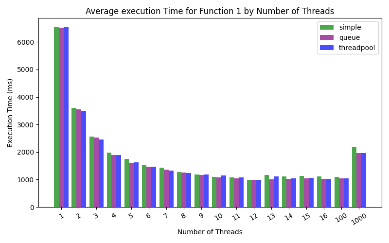
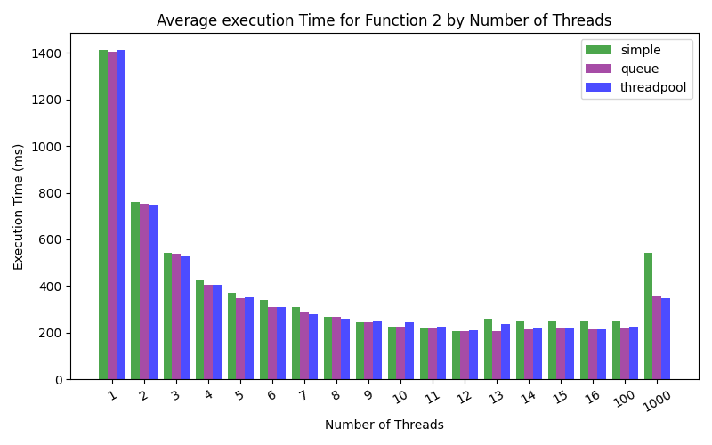
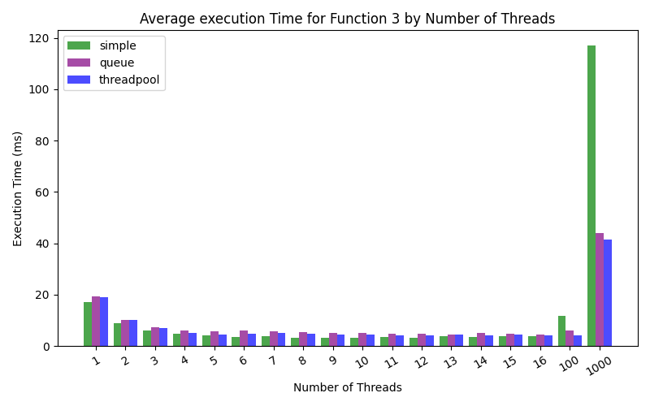

## Порівняння за допомогою Wilcoxon test
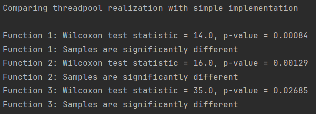
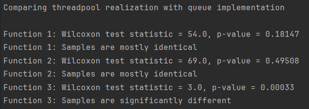

Як бачимо з діаграм та тестів, наведених вище, наша реалізація з тредпулом працює швидше за звичайну паралелізацію й приблизно на рівні з паралелізацією за допомогою окремих черг - це доволі очікувано, адже тредпул в нашому випадку це здебільшого інкапсуляція тієї ж логіки, що використовувалася у минулій практичній. Цікаво, що суттєва різниця між цими двома підходами все ж прослідковується у третій функції.

## Порівняння графіків ефективності паралелизації

Графіки для попередніх реалізацій представлені у відповідних секціях вкінці звіту.

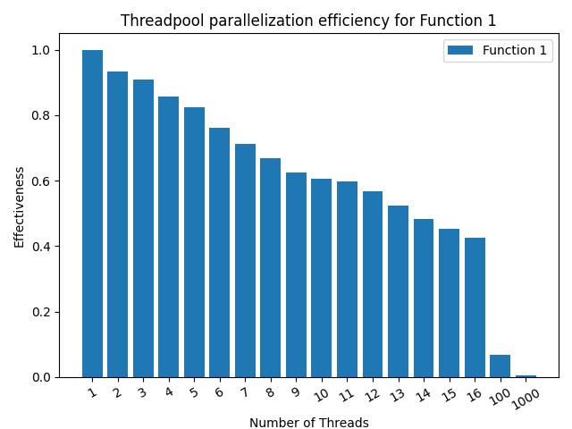
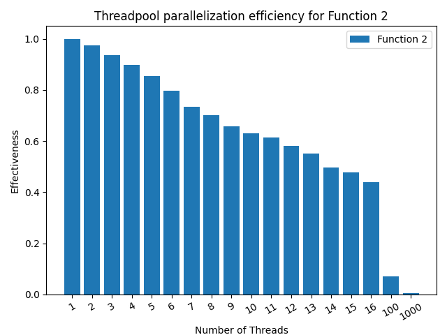
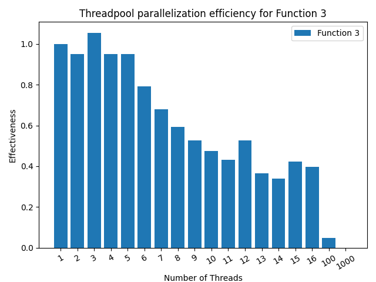

Знову ж, загалом графіки ефективності дуже схожі зі своїми відповідниками з попередньої практичної, зауваження про основні відмінності від практичної 3 також ті ж - повільніше спадання ефективності для перших двох функцій, наприклад. З цікавого - графік ефективності для 3 функції виглядає набагато краще за реалізацію з чергами й навіть змагається з результатами практичної 3. Особливо кидається в очі надлінійне прискорення на трьох потоках, а також помітне зростання ефективності на п'ятнадцяти та шістнадцяти потоках - схоже, хоч в середньому на третій функції проста реалізація переганяє тредпул, мінімальні часи виконання в них доволі близькі.

## Загальні висновки та пояснення

За результатами даної роботи бачимо, що загалом реалізація через тредпул доволі близька до реалізації з чергами - знову ж таки, це доволі логічно, адже тредпул великою мірою представляє собою інкапсуляцію ідей попередньої практичної у єдину сутність. Відповідно, різниця між реалізацією практичної 5 та практичної 3 також схожа на те, що було у практичній з чергами.
Тим не менше, було декілька цікавих відмінностей - зокрема, що оптимальна кількість точок у розбитті трохи зменшилася (від 140 до 119) порівняно з попередньою роботою, а також найцікавіший момент - різниця швидкодії між чергами й тредпулом для 3 функції. Тут маємо декілька припущень: з одного боку, найбільші відмінності між цими двома реалізаціями - в попередній практичній ми використовували 2 черги, в цій - одну, а іншу замінили комбінацією promise та future, можливо, це вплинуло на результат. Також у цій реалізації ми активно використовували оператор переміщення, можливо це вплинуло на швидкодію чи роботу з пам'яттю. Крім того, оскільки за реалізації з тредпулами бачимо навіть суперскалярне прискорення, можемо припускати, що дана реалізація якось краще користується кешом - можливо, через той ж оператор переносу, або й з якихось інших причин.

## Додаткове завдання 1

Для комбінації відповідного виконавчого файлу потрібно компілювати проєкт з опцією COMPILE_FOLLY=ON. Назва відповідного python раннера - ./runner_integral_parallel_folly.py
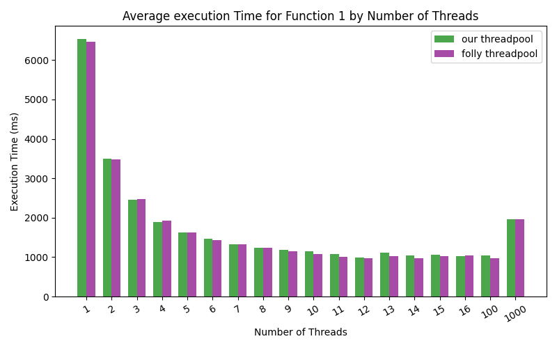
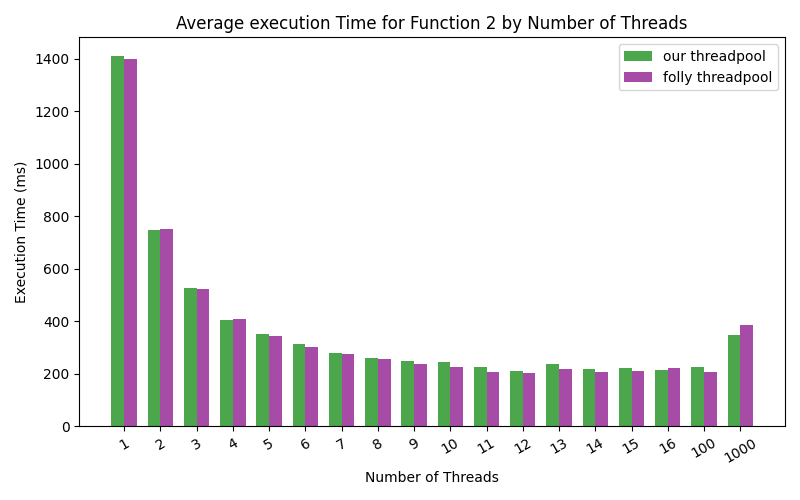
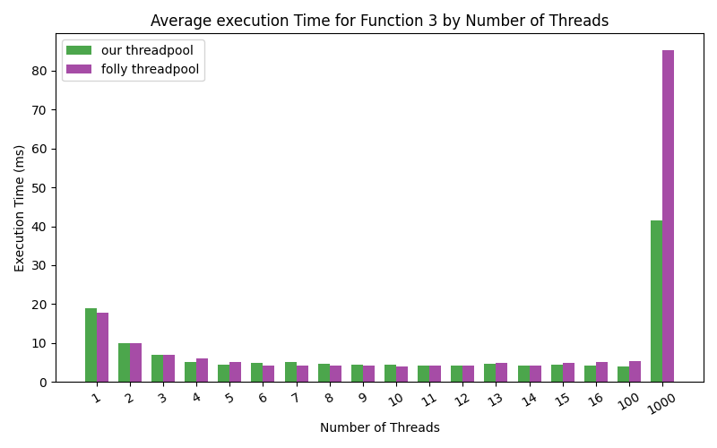

Як бачимо, результати роботи двох підходів доволі близькі, хоч реалізація folly все ж дещо переважає у більшості ситуацій. Цікаво, що найближчі результати у 3 функції - можливо, facebook::folly не оптимізована для таких малих підзадач. Також можна підмітити, що ця реалізація суттєво більше страждає від нераціональної кількості потоків (зокрема, 1000).


## Додаток

### Графіки ефективності паралелізації для практичної 3
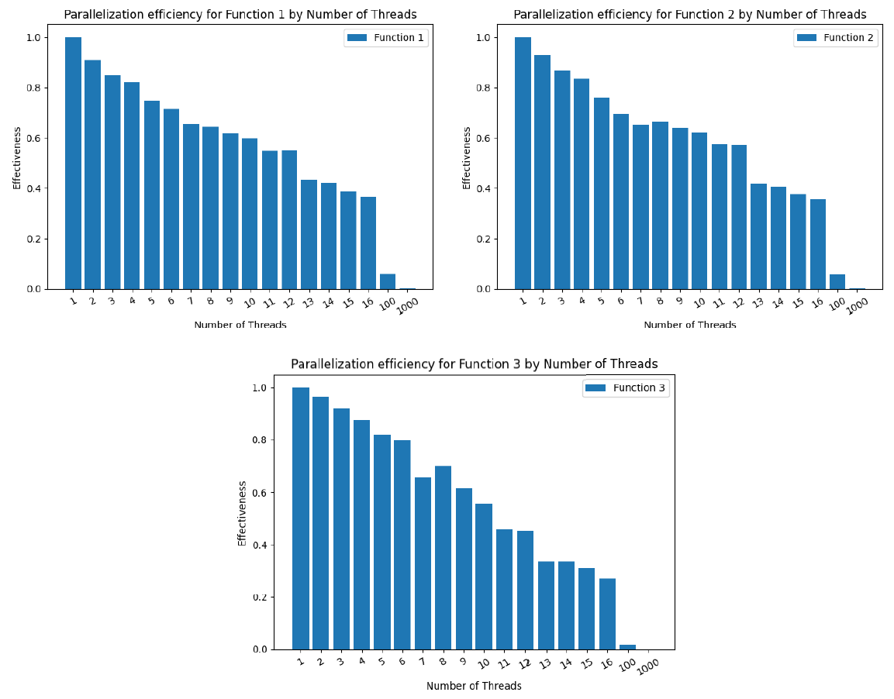

### Графіки ефективності паралелізації для практичної 4
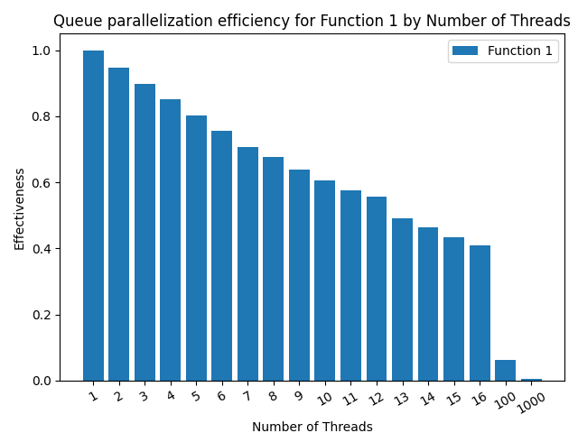
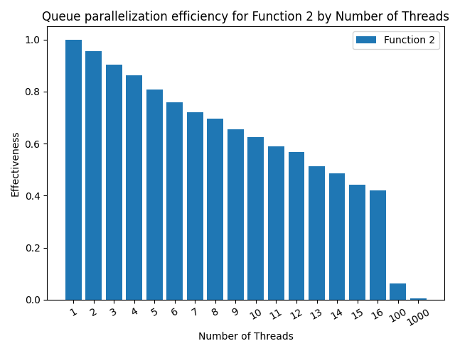
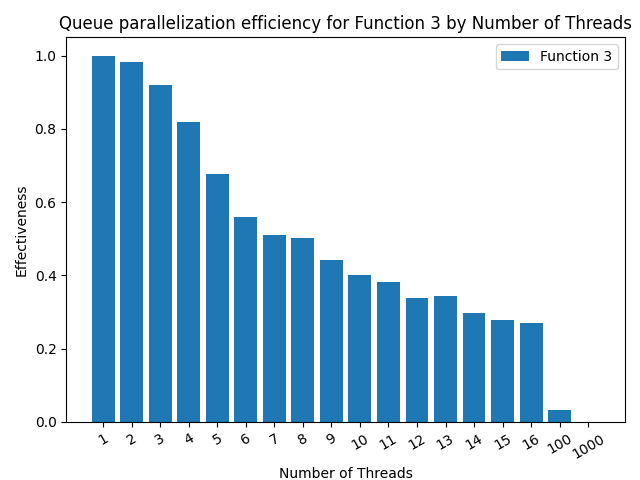
