# Lab work 7: Consequent words counting

Authors (
team): [Valihurskyi Anton](https://github.com/BlueSkyAndSomeCurses), [Kravchuk Yevhenii](https://github.com/eugenekravchuk), [Kuzma Volodymyr](https://github.com/Kuzmarg)

## Prerequisites

- g++
- cmake
- make
- python3
- LibArchive (`sudo apt install libarchive-dev`)
- boost (`sudo apt install libboost-all-dev`)
- ICU (`sudo apt install libicu-dev`)
- Abseil (`sudo apt install libabsl-dev`)

### Compilation

```
./compile.sh -o
```

```shell
mkdir build && cd build
cmake ..
make all
```

### Installation

```
git clone https://github.com/ucu-cs/lab7-words-count-unicode-valihurskyi_kuzma_kravchuk
```

### Usage

```
python3 ./python_scripts/runner.py <num_of_iterations (>1)> <flush (0|1)>
```

# Report

## Сomputers

**Комп'ютер 1:**

- Процесор: Intel i7-12650H
    - Physical cores: 10
    - Logical cores: 16
    - P-cores: 6
    - E-cores: 4
- RAM: DDR5 4800
- Storage: SAMSUNG MZVL21T0HCLR-00B07
    - Sequential Read 7000 MB/s
    - Sequential Write 5100 MB/s'

**Комп'ютер 2:**

- Процесор: AMD Ryzen 7 4800H
    - Physical cores: 8
    - Logical cores: 16
    - P-cores: 8
    - E-cores: 0
- RAM: DDR4 3200
- Storage: INTEL SSDPEKNW512G8L (C04C)
    - Sequential Read 1646 MB/s
    - Sequential Write 826 MB/s

** Комп'ютер 3:**

- Процесор apple M4 pro
    - efficiency cores: 4
    - performance cores: 8
- RAM: DDR5 24gb
- Storage: not exposed

** Комп'ютер 4 **

- процесор amd ryzen 2600x
- RAM: DDR3 2333 Mhz 16gb
- storage: ssd read 501.6 MB/sec (estimated with `hdparm`)
- hdd: read 91 MB/sec

## Main part

Counting words of whole library took total 2281114 ms and for writing 40526 on computer (m4 pro).
Resulting files can be
found [here](https://drive.google.com/drive/folders/14OzWqQcOhiVb1T6qrZyrJUGGfqEF-YMe?usp=sharing).


We have used `hotspot` to analyze places in our code that take up most of our cycles. From previous lab work we expected
that boost's methods will slow down code the most.
And it indeed turned out to be true. Working with utf requires to iterate over all bytes, and thus it is so inefficient.

We suspected that LibArchive will also take a lot of cycles, however it is not so.

All relevant metrics for smaller directories can be found in section with result of Extra 1.

## Additional Results

### Extra 1

На 1 та 2 комп'ютерах є лише SSD-накопичувач, тому тестування проводилось лише на SSD.

Було запущено `python_scripts/runner.py` на меншому датасеті (`gutenberg_ascii_en_part.iso`, папка `7`) з параметрами
`3 0` (3 ітерації, без очищення кешу).  
Результати:

- Комп'ютер 1
  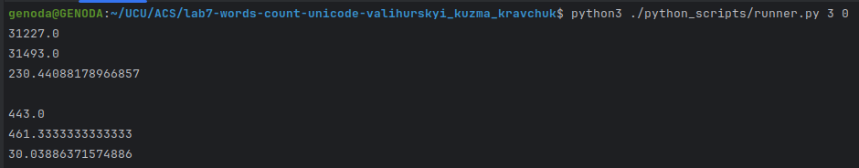
- Комп'ютер 2
  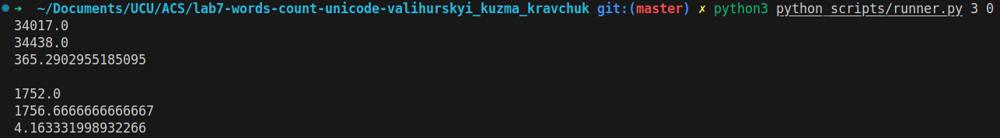

---

Ми запустили код на директорії `/7/7` з бібліотеки Гуттенберга на ssd i hdd. По 7 разів.

| Метрика               | `ssd` no buffer cleaning | `ssd` with buffer cleaning | `hdd` without buffer cleaning | `hdd` with buffer clearing |
|-----------------------|--------------------------|----------------------------|-------------------------------|----------------------------|
| **Min Total (мс)**    | 12616.0                  | 12939.0                    | 12568.0                       | 12857.0                    |
| **Avg Total (мс)**    | 12835.0                  | 13074.5                    | 12811.42                      | 13157.14                   |
| **StdDev Total (мс)** | 121.05                   | 91.6                       | 161.3                         | 204.26                     |
| **Min Write (мс)**    | 884.0                    | 889.0                      | 882.0                         | 878.0                      |
| **Avg Write (мс)**    | 902.67                   | 909.71                     | 902.42                        | 895.14                     |
| **StdDev Write (мс)** | 14.17                    | 18.1                       | 15.76                         | 17.3                       |

Ми бачимо, що враховуючи, що hdd у 5 разів повільніший за ssd сильного сповільнення не відбувається. Точніше без
очищення буферів його взагалі майже немає.
Це дивно. Проте це може бути пов'язано з тим, що саме читання і запис відбуваються великими шматками в RAM. Тому можливо
процесор має якусь оптимізацію, що наперед каже hdd куди покрутити головкою.
Очевидно, що з почищеними буферами працює повільніше, оскільки тоді система вимушена читати на пряму з повільного
storage.

### Extra 2

(скрипт виконано на комп'ютері 1)

У файлі `src/word_counter.cpp` ми імплементували функцію `read_file_mmap`, яка дозволяє використовувати відображення
файлів у пам'ять (`mmap`) для ефективного читання архівів:

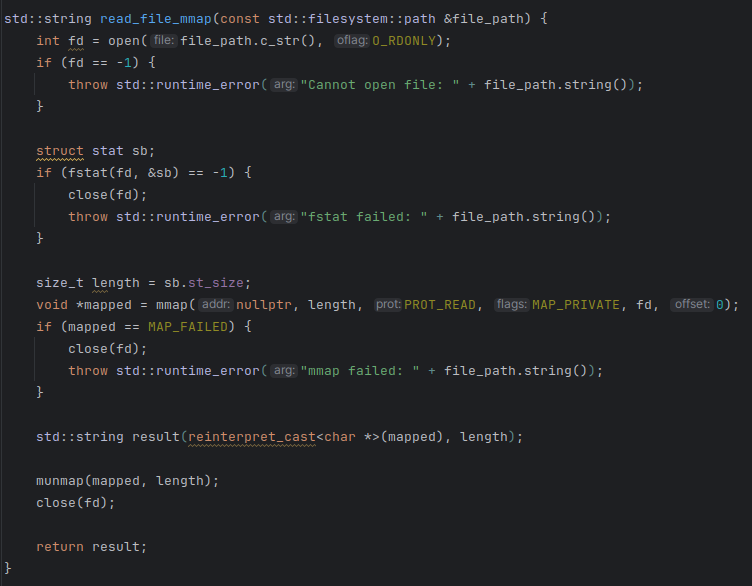

Було виконано 3 ітерації з тією ж папкою (`7`):

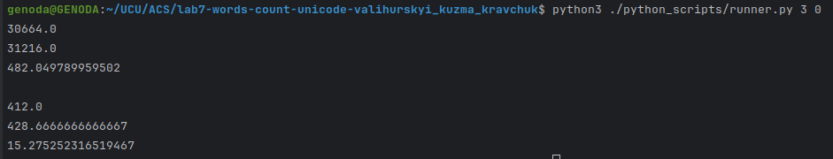

#### Порівняння результатів (3 ітерації, без очищення кешу)

| Метрика               | `mmap`  | `ifstream` |
|-----------------------|---------|------------|
| **Min Total (мс)**    | 30664.0 | 31227.0    |
| **Avg Total (мс)**    | 31216.0 | 31493.0    |
| **StdDev Total (мс)** | 482.05  | 230.44     |
| **Min Write (мс)**    | 412.0   | 443.0      |
| **Avg Write (мс)**    | 428.67  | 461.33     |
| **StdDev Write (мс)** | 15.28   | 30.04      |

#### Висновки

- `mmap` показав **швидший доступ до файлів** і **менший час запису**.
- Незначне збільшення `stddev total` можна пояснити специфікою роботи з віртуальною пам’яттю.

---

### Extra 3

(скрипт виконано на комп'ютері 1)

Було створено 3 ISO-файли з різним рівнем фрагментації:

- `iso_linear.iso` (10 extent'ів)  
  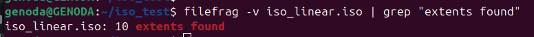
- `iso_mid_frag.iso` (11 extent'ів)  
  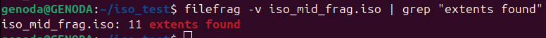
- `iso_heavy_frag.iso` (13 extent'ів)  
  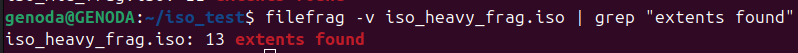

Час обробки для кожного випадку (3 ітерації, без очищення кешу):

- Найменша фрагментація:  
  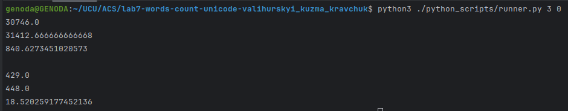
- Середня фрагментація:  
  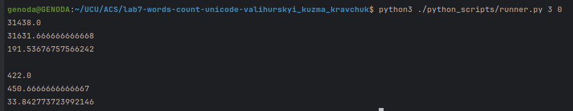
- Найбільша фрагментація:  
  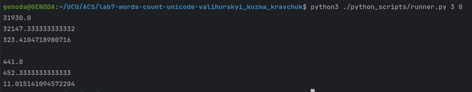

#### Порівняння (3 ітерації, без очищення кешу)

| Метрика               | 10 extent'ів (лінійна) | 11 extent'ів (середня) | 13 extent'ів (фрагментована) |
|-----------------------|------------------------|------------------------|------------------------------|
| **Min Total (мс)**    | 30746.0                | 31438.0                | 31930.0                      |
| **Avg Total (мс)**    | 31412.67               | 31631.67               | 32147.33                     |
| **StdDev Total (мс)** | 840.63                 | 191.53                 | 323.44                       |
| **Min Write (мс)**    | 429.0                  | 422.0                  | 441.0                        |
| **Avg Write (мс)**    | 448.0                  | 450.67                 | 453.33                       |
| **StdDev Write (мс)** | 18.52                  | 33.84                  | 11.02                        |

#### Висновки

- Збільшення фрагментації **негативно впливає на час обробки**.
- Навіть +3 extent'и (з 10 до 13) дають ~700 мс різниці у середньому.
- Запис результатів (`Write`) практично не залежить від фрагментації.

---

### Extra 4

(скрипт виконано на комп'ютері 1)

У `src/word_counter.cpp` реалізовано альтернативну функцію обробки тексту — `process_text_with_icu`, яка замінює
`boost::locale` на ICU для токенізації та нормалізації слів.

#### Код функції:

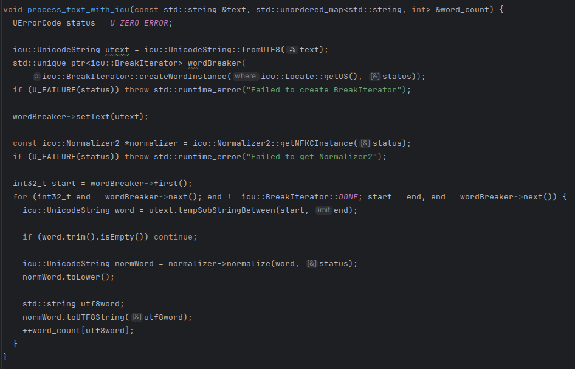

#### Результати виконання (3 ітерації, без flush)

Тест виконано командою:

```bash
python3 ./python_scripts/runner.py 3 0
```

Результати для ICU:

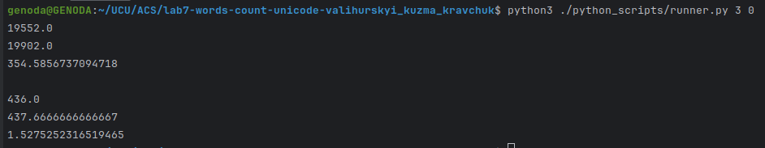

#### Порівняння продуктивності

| Метрика               | **ICU** | **Boost.Locale** |
|-----------------------|---------|------------------|
| **Min Total (мс)**    | 19552.0 | 30664.0          |
| **Avg Total (мс)**    | 19902.0 | 31216.0          |
| **StdDev Total (мс)** | 354.59  | 482.05           |
| **Min Write (мс)**    | 436.0   | 412.0            |
| **Avg Write (мс)**    | 437.67  | 428.67           |
| **StdDev Write (мс)** | 1.53    | 15.28            |

---

#### Висновки

- **ICU працює значно швидше**, ніж Boost.Locale:
    - Середній час обробки (`Avg Total`) менший майже на **11 секунд**.
- Запис результатів (`Writing`) у ICU трохи повільніший по мінімальному значенню, але:
    - **Набагато стабільніший** (`StdDev = 1.53` проти 15.28 у Boost).
- **Висновок**: використання ICU забезпечує **кращу продуктивність і стабільність** у задачах токенізації/нормалізації
  тексту.

### Extra 5

При конфігурації CMake з допомогою -DUSE_MAP=ON чи -DUSE_ABSEIL_HASH_MAP=ON можна змінити використану структуру на std::
map або absl::flat_hash_map. У випадку з map при записі було пропущено сортуванням у алфавітному порядку (адже структура
автоматично посортована).

Тести ефективності при використанні структур було виконано на комп'ютері 2 з використанням
`gutenberg_ascii_en_part.iso`, папки `7`:

```bash
python3 ./python_scripts/runner.py 3 0
```

#### Результати порівняння

| Метрика               | **std::map** | **std::unordered_map** | **absl::flat_hash_map** |
|-----------------------|--------------|------------------------|-------------------------|
| **Min Total (мс)**    | 44777.0      | 34017.0                | 32651.0                 |
| **Avg Total (мс)**    | 45286.7      | 34438.0                | 32979.7                 |
| **StdDev Total (мс)** | 746.071      | 365.290                | 328.002                 |
| **Min Write (мс)**    | 1743.0       | 1752.0                 | 1913.0                  |
| **Avg Write (мс)**    | 1751.3       | 1756.7                 | 2196.3                  |
| **StdDev Write (мс)** | 11.930       | 4.1633                 | 299.37                  |

#### Висновки

- **std::map**: очікувано повільніша структура, оскільки реалізована на основі дерева з логарифмічною складністю
  додавання елементів, що значно перевищує виграш від автоматичного сортування у цьому випадку.
- **std::unordered_map**: показала загалом значно кращі результати, ніж std::map. При цьому час запису навіть враховуючи
  додаткове сортування практично не відрізняється, тож у структури явний виграш над std::map.
- **absl::flat_hash_map**: показала найкращі результати, переганяючи навіть std::unordered_map. Додатково - час запису у
  цьому випадку виявився більшим, проте, звертаючи увагу на великі відхилення, це може бути пов'язано з іншими
  ІО-операціями, що відбувались на фоні у системі. В такому разі, навіть враховуючи їх, структура показала кращі
  результати.
