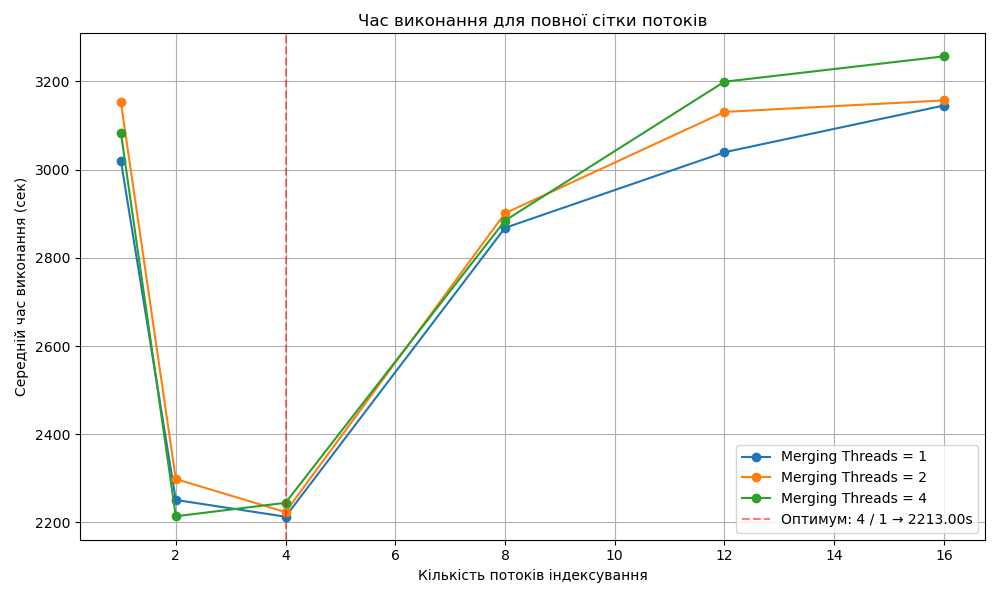
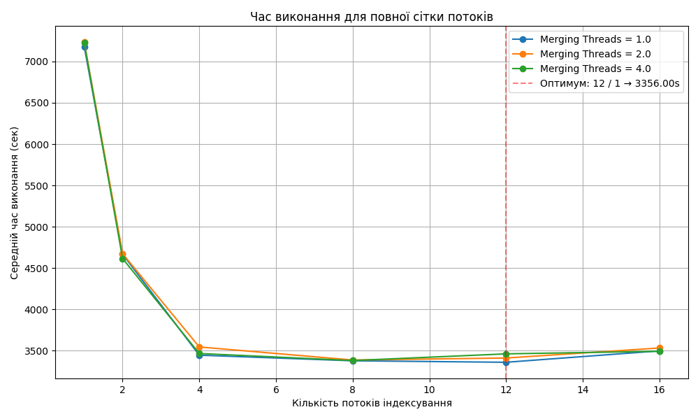
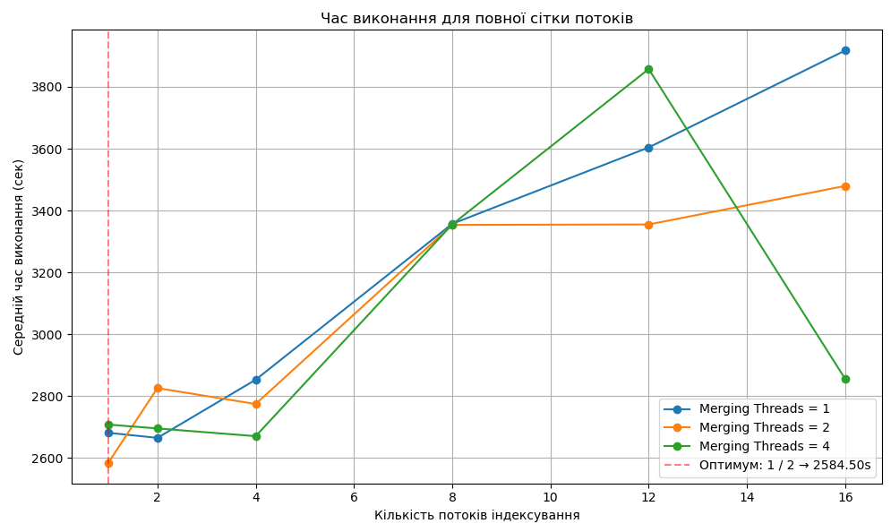
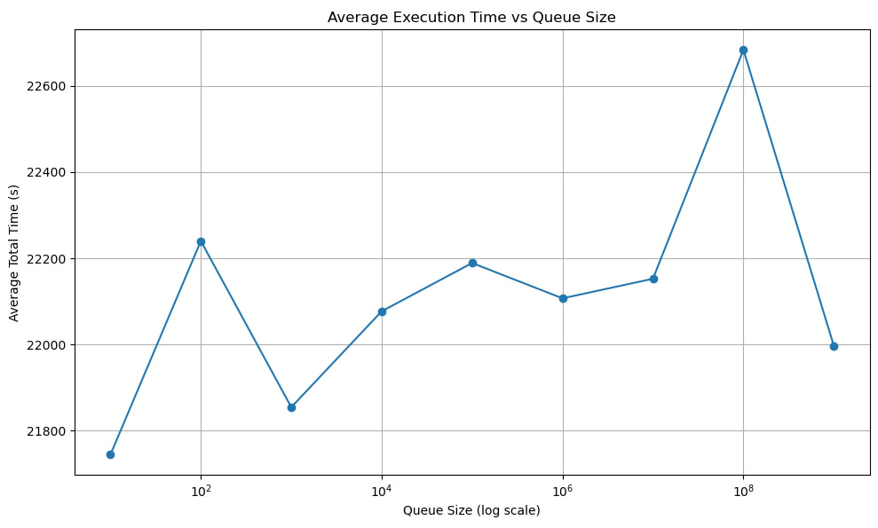
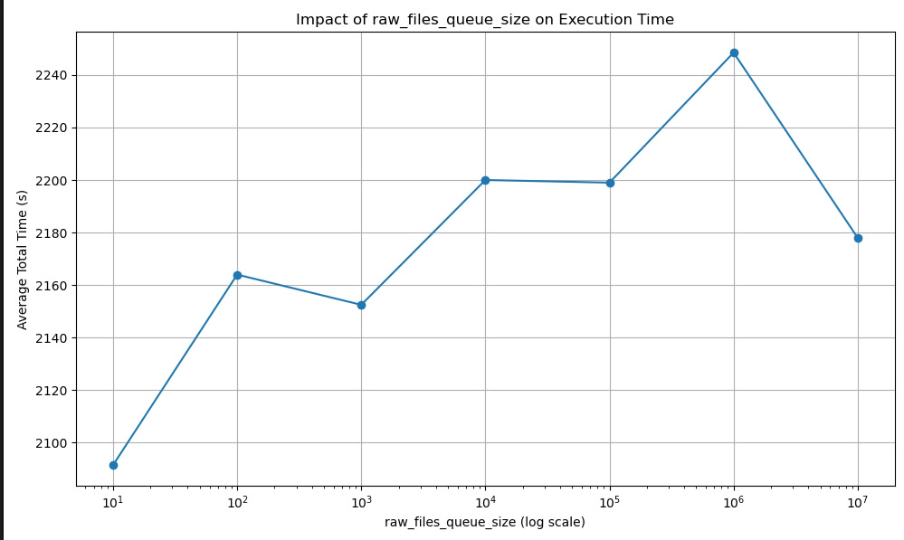
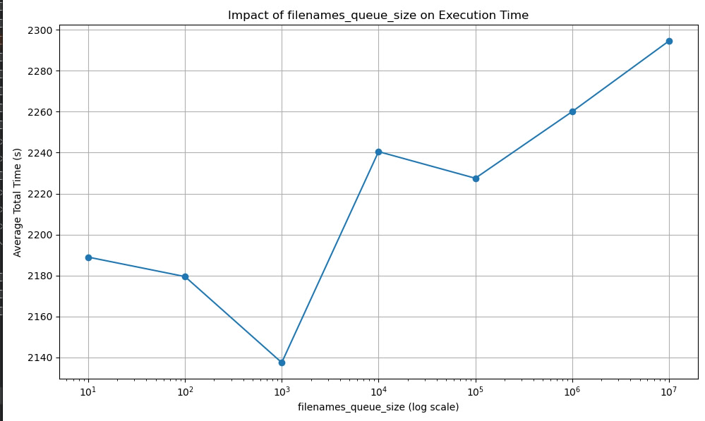
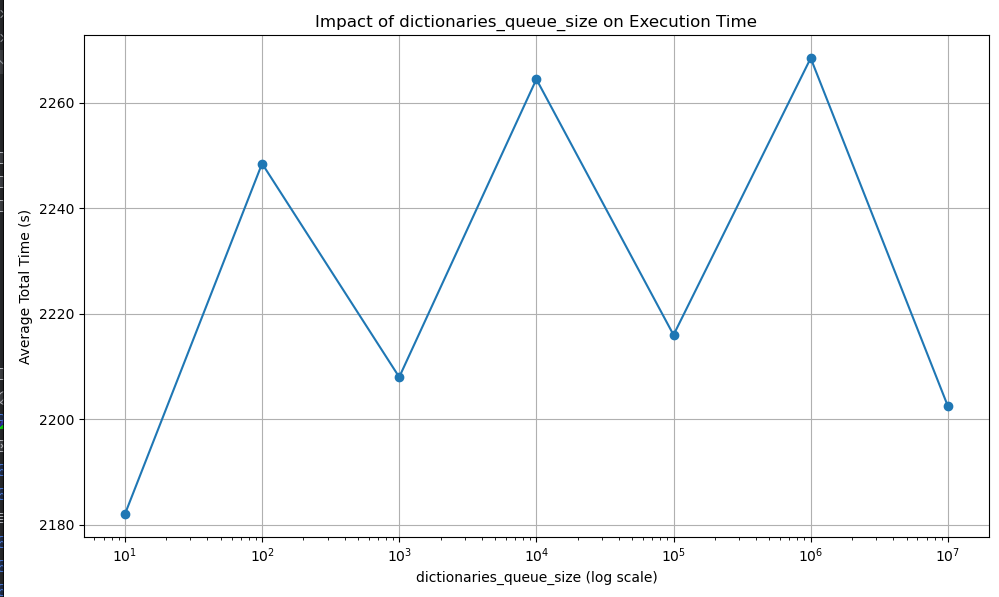
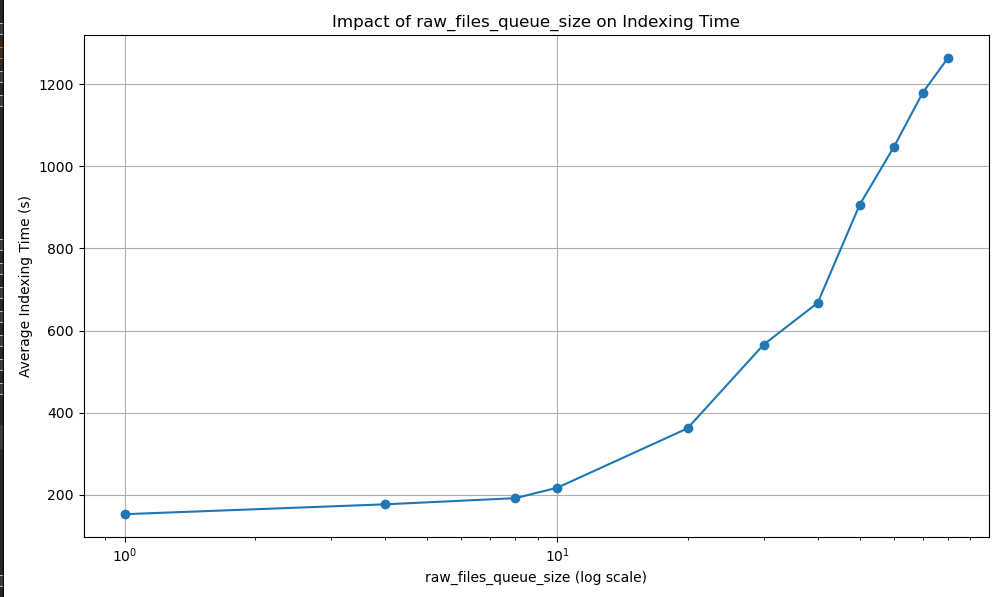
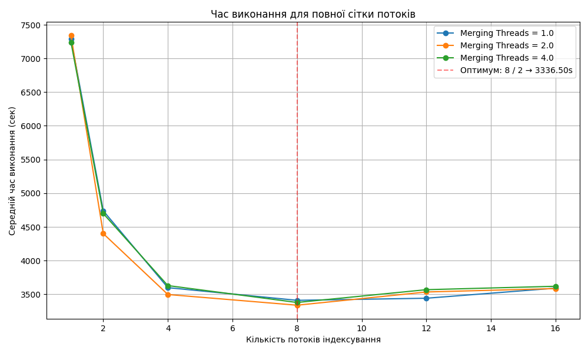
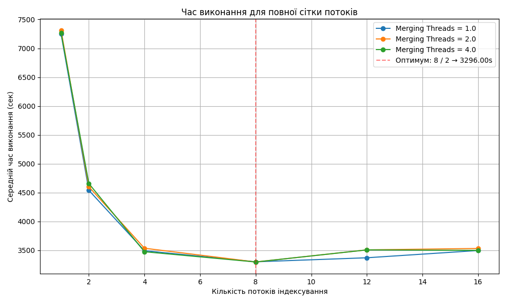

# Lab work 8: Parallel words counting

Authors (
team): [Valihurskyi Anton](https://github.com/BlueSkyAndSomeCurses), [Kravchuk Yevhenii](https://github.com/eugenekravchuk), [Kuzma Volodymyr](https://github.com/Kuzmarg)

## Prerequisites

- g++
- cmake
- make
- python3 (for requirements - `pip install -r requirements.txt`)
- LibArchive (`sudo apt install libarchive-dev`)
- boost (`sudo apt install libboost-all-dev`)
- ICU (`sudo apt install libicu-dev`)
- Abseil (`sudo apt install libabsl-dev`)

### Compilation

```
./compile.sh -o
```

```shell
mkdir build && cd build
cmake ..
make all
```

### Installation

```
git clone https://github.com/ucu-cs/lab7-words-count-unicode-valihurskyi_kuzma_kravchuk
```

### Usage

```
python3 ./python_scripts/runner.py <num_of_iterations (>1)> <flush (0|1)>
```

<mark>РЕМАРКА</mark>
Потокобезпечна черга взяти з лабораторної роботи команди Володимир Кузьма, Назар Слаблюк, Антон Валігурський.
Де перший один з виконавців цієї лабораторної роботи.

# Report

## Сomputers

**Комп'ютер 1:**

- Процесор: Intel i7-12650H
    - Physical cores: 10
    - Logical cores: 16
    - P-cores: 6
    - E-cores: 4
- RAM: DDR5 4800
- Storage: SAMSUNG MZVL21T0HCLR-00B07
    - Sequential Read 7000 MB/s
    - Sequential Write 5100 MB/s'

**Комп'ютер 2:**

- Процесор: AMD Ryzen 7 4800H
    - Physical cores: 8
    - Logical cores: 16
    - P-cores: 8
    - E-cores: 0
- RAM: DDR4 3200
- Storage: INTEL SSDPEKNW512G8L (C04C)
    - Sequential Read 1646 MB/s
    - Sequential Write 826 MB/s

**Комп'ютер 3:**

- Процесор apple M4 pro
    - efficiency cores: 4
    - performance cores: 8
- RAM: DDR5 24gb
- Storage: not exposed

**Комп'ютер 4:**

- процесор amd ryzen 2600x
- RAM: DDR3 2333 Mhz 16gb
- storage: ssd read 501.6 MB/sec (estimated with `hdparm`)
- hdd: read 91 MB/sec

## Main part

Counting words of whole library took total 967122 ms, reading 922757 ms, finding files 858418 ms, and for writing 40755
with 4 indexing threads and 2 merging threads on computer (m4 pro).
Resulting files can be
found [here](https://drive.google.com/drive/folders/14OzWqQcOhiVb1T6qrZyrJUGGfqEF-YMe?usp=sharing).

#### Efficiency

We've built a graph of efficiency of parallelization (`gutenberg_ascii_en_part.iso`, folder `7`) :


To investigate the parallelization efficiency, we chose options for the number
of indexing threads (from 1 to 16) and merge threads (1, 2, 4).
Such parameters allow us to cover the entire available range of
hardware parallelism of the processor (16 cores), while not creating excessive overload on the less costly phase of
dictionary merging.

The results demonstrate the classical behavior according to Amdahl's law: as the number of threads grows, efficiency
decreases due to competition for resources and restrictions by unparallelized code sections.

#### Hotspot

We have used `hotspot` to analyze places in our code that take up most of our cycles. From previous lab work we expected
that boost's methods will slow down code the most.
And it indeed turned out to be true. Working with utf requires to iterate over all bytes, and thus it is so inefficient.

We suspected that LibArchive will also take a lot of cycles, however it is not so.

All relevant metrics for smaller directories can be found in section with result of Extra 1.

# Additional Results

## Comparison on different computers

На 1 та 2 комп'ютерах є лише SSD-накопичувач, тому тестування проводилось лише на SSD.

Було запущено `python_scripts/optimal_threads_plot.py` на меншому датасеті
(`gutenberg_ascii_en_part.iso`, папка `/7/7`).

Результати:

- Комп'ютер 1
  

  У ході дослідження було виконано серію запусків багатопотокового
  застосунку з варіативною кількістю потоків індексування
  (indexing_threads ∈ {1, 2, 4, 8, 12, 16}) та потоків  
  об'єднання словників (merging_threads ∈ {1, 2, 4}).</br> </br>

  На графіку зображено середній час виконання задачі (у мілісекундах) залежно від кількості потоків індексування, з
  розподілом по різних значеннях merging_threads.  </br></br>

  Оптимальна конфігурація

    - Найменший час виконання досягнуто при:
        - indexing_threads = 4
        - merging_threads = 1
        - Середній час: 2213 мс (2.2 сек)


- Комп'ютер 2
  
  Оптимальна конфігурація

    - Найменший час виконання досягнуто при:
        - indexing_threads = 12
        - merging_threads = 1
        - Середній час: 3356 мс (3.3 сек)

  `perf stat` для запуску з оптимальною конфігурацією показує 4.09% cache-missses та 3.16% branch-misses. Це з одного
  боку свідчить про хорошу локальність даних, адже звертання до пам'яті відбувались лише 4% разів, проте з іншого боку
  видно відносно низьку точність передбачень переходів.

---

## Dynamic dispatching of flows

У проєкті реалізовано динамічну диспетчеризацію потоків для адаптивного розподілу обчислювальних
ресурсів між двома основними типами задач:

- індексування та розпакування файлів (архіви та текст),
- підрахунок слів у текстах.

### Принцип роботи

Реалізовано класи DynamicDispatcher та ThreadPool в `include/dispatcher.h` та `include/threadpool.h`.
Основна логіка знаходиться в `src/word_counter_dynamic.cpp`

Ключовим компонентом є клас DynamicDispatcher, який керує пулом потоків, розподіляючи задачі з черги raw_files_queue у
потоки, що виконують unarchive_parse_index(...). Диспетчер не фіксує кількість потоків, а керує їхнім життєвим циклом
динамічно, залежно від навантаження (розміру черг задач).

Такий підхід дозволяє:

- перерозподіляти ресурси між задачами підрахунку та індексування в режимі реального часу;
- уникати переповнення або простою потоків;
- досягати кращого балансу навантаження при роботі з великими та різнорідними наборами файлів (архіви + текст).

### Порівняння часу роботи

(Заранено на комп 1)

Основний підхід:  


Dynamic dispatching of flows:


#### Основний підхід (статичне розподілення)

- **Оптимум:** `indexing = 4`, `merging = 1`
- **Найкращий час:** **2213 сек**
- **Характерна поведінка:** класична U-подібна форма:
    - при малій кількості потоків — висока тривалість;
    - при `4` — мінімум;
    - подальше збільшення — погіршення продуктивності (перевантаження системи, кеш-конфлікти, тощо).

**Висновок:**  
Статична стратегія добре масштабується до певного порогу, далі — зниження ефективності.

---

#### Динамічна диспетчеризація

- **Оптимум:** `indexing = 1`, `merging = 2`
- **Найкращий час:** **2584 сек**
- **Спостереження:**
    - найкращі результати — при мінімальній кількості потоків індексування;
    - при збільшенні — час зростає, особливо при `merging = 4`.

**Висновок:**  
Динамічна модель поки **не перевершує статичну**, що може бути пов'язано з:

- недостатньо адаптивною логікою диспетчера;
- затримками при балансуванні;
- нерівномірним навантаженням або «втомою» потоків.

---

#### Порівняльна таблиця

| Критерій                        | Статичне розподілення                   | Динамічне                           |
|---------------------------------|-----------------------------------------|-------------------------------------|
| Найкращий час виконання         | 2213 с                                  | 2584 с                              |
| Оптимальна конфігурація потоків | `indexing = 4`, `merging = 1`           | `indexing = 1`, `merging = 2`       |
| Поведінка при масштабуванні     | U-подібна, прогнозована                 | Нестабільна, неочікувана            |
| Потенційна перевага             | Максимум ефективності при сталих умовах | Гнучкість при змінному навантаженні |

---

#### Висновок

- Якщо навантаження передбачуване і стабільне — **статичне розподілення краще**.
- Якщо дані гетерогенні, непередбачувані — **динамічна диспетчеризація має потенціал**, але її потрібно **допрацювати
  ** (наприклад, адаптивне регулювання кількості потоків на основі стану черг у реальному часі).

## Queue size and speed

(Зроблено на комп 1)

Побудовано графік швидкодії для різного розміру черги (`gutenberg_ascii_en_part.iso`, папка `/7/7`):  


#### Спостереження:

| Розмір черги     | Поведінка                                                                                                |
|------------------|----------------------------------------------------------------------------------------------------------|
| `10^1` (10)      | Найменший час (~21800 с) — **найкраща швидкодія**.                                                       |
| `10^2` (100)     | Значне погіршення (~22250 с).                                                                            |
| `10^3 – 10^5`    | Зменшення часу до рівня ~21850–22150 с.                                                                  |
| `10^6 – 10^7`    | Відносна стабільність, невеликі коливання.                                                               |
| `10^8` (100 млн) | Найгірший результат (~22650 с), можливо через **перевитрату пам’яті** або **page fault'и**.              |
| `10^9` (1 млрд)  | Різке покращення (~22000 с), потенційно — внаслідок "чистої" алокації або впливу ОС. Потребує уточнення. 

---

#### Висновки:

- **Оптимальний діапазон розміру черги:** від `10` до `10^4`.
- Малі черги:
    - Мінімізують затримки.
    - Працюють добре для обмеженого паралелізму.
- Надто великі черги:
    - Можуть призвести до зниження швидкодії через:
        - надмірне використання оперативної пам’яті;
        - кеш-промахи;
        - пейджінг (вивантаження в swap).
- **Збалансована зона**: `10^3 – 10^5` — гарне поєднання розміру та швидкодії.

#### Аналіз впливу розміру черг на швидкодію

У дослідженні розглядалося три типи черг:

- **`raw_files_queue_size`** — черга з вмістом файлів;
- **`filenames_queue_size`** — черга з іменами файлів;
- **`dictionaries_queue_size`** — черга з частковими словниками.

---

#### `raw_files_queue_size`



- При `10` — найменший час (~2090 с), що свідчить про високу ефективність.
- При `100–10^3` — спостерігається незначне погіршення.
- При `10^4 – 10^6` — час зростає і стабілізується (~2190–2250 с).
- При `10^7` — зниження часу, але не до початкового рівня.

**Висновок:**  
Надто великі черги **знижують кеш-ефективність**, призводять до зайвих витрат памʼяті. **Оптимум — в межах `10 – 1000`
**.

---

#### `filenames_queue_size`



- Найкращий час (~2135 с) досягається при `10^3`.
- При `10–10^2` — дещо гірші результати.
- При `10^4 – 10^7` — поступове та значне погіршення, аж до ~2290 с.

**Висновок:**  
Найкраще працює при **середньому розмірі черги**. **Занадто великі черги погіршують продуктивність** — імовірно через
вплив на фазу читання та передачі імен файлів.

---

#### `dictionaries_queue_size`



- Графік має **нестабільний, пилкоподібний вигляд**.
- Час коливається між ~2180 с і ~2270 с.
- Явного тренду немає, а різкі коливання свідчать про **залежність від внутрішнього планування потоків** або чергування
  фаз підрахунку/злиття.

**Висновок:**  
`dictionaries_queue_size` **не має визначального впливу** на загальний час, якщо перебуває в адекватному діапазоні (
`10^3 – 10^5`). Можливі флуктуації — побічний ефект конкурентного доступу до черги.

---

### ✅ Загальний висновок

| Черга                     | Оптимальний діапазон | Чутливість до розміру | Коментар                                                  |
|---------------------------|----------------------|-----------------------|-----------------------------------------------------------|
| `raw_files_queue_size`    | `10 – 10^3`          | Висока                | Впливає безпосередньо на завантаження індексуючих потоків |
| `filenames_queue_size`    | `10^2 – 10^3`        | Середня               | Забезпечує достатнє наповнення без перевантаження         |
| `dictionaries_queue_size` | `10^3 – 10^5`        | Низька                | Головне — уникнути переповнення, решта компенсується      |

## Indexation time and queue size

### Протокол дослідження: Залежність часу індексації від розміру черг

#### Мета дослідження

Дослідити, як розмір черг, зокрема **черги із вмістом файлів** (`raw_files_queue_size`), впливає на **загальний час
індексації** у багатопотоковому застосунку для обробки текстів і архівів.

---

#### Контекст

У програмі використовується три основні черги:

- `filenames_queue_size` — черга з іменами файлів;
- `raw_files_queue_size` — черга з вмістом файлів (ключова в цьому дослідженні);
- `dictionaries_queue_size` — черга з частковими словниками.

---

#### План експерименту

1. **Варіювати** лише **одну чергу** — `raw_files_queue_size`, інші тримати **фіксованими**.
2. Розміри для тестування:  
   `10`, `100`, `1000`, `10_000`, `100_000`, `1_000_000`, `10_000_000`
   (тобто степені десятки, у логарифмічному масштабі).
3. Запускати кожну конфігурацію **двічі** і обчислювати **середній час виконання**.
4. Заміряти саме `Total` час виконання програми (у мілісекундах або секундах).
5. Побудувати графік:

- **X:** Розмір черги (лог. шкала)
- **Y:** Середній час індексації

---

#### Фіксовані умови

- `filenames_queue_size = 1000`
- `dictionaries_queue_size = 1000`
- `indexing_threads = 4`
- `merging_threads = 2`
- Система: [описати CPU, RAM, SSD/HDD]

---

#### Очікувані результати

- При **малих значеннях черги** (10–100) можливе затримування потоків через **брак задач** — висока латентність.
- При **дуже великих чергах** (1 млн+) можлива **втрата кеш-ефективності**, **надмірне споживання RAM**, page fault'и
  або swap.
- **Оптимум очікується в діапазоні `1000 – 100_000`**, де черга достатньо велика для ефективного паралелізму, але ще не
  шкодить системі.

---

#### Ціль дослідження

Визначити **оптимальний діапазон розмірів черги із вмістом файлів**, за якого досягається **найменший час індексації**
при фіксованих інших параметрах.

### Виконання

Для того щоб отримати indexing time потрібно добавити в конфігурацію рядок: `measure_indexing_time = true`

Ми отримали такий граф:


#### Ключові спостереження

| Діапазон черги | Поведінка часу індексації        | Коментар                                                               |
|----------------|----------------------------------|------------------------------------------------------------------------|
| `1 – 5`        | Низький час (~150–200 сек)       | Потоки працюють без затримок, черга постійно заповнена                 |
| `10 – 50`      | Плавне зростання до ~350–400 сек | Зʼявляється деяка затримка через накопичення                           |
| `100 – 1000+`  | Різке зростання до 1200+ сек     | Черга стає "глибокою", зниження кеш-ефективності, можливо page fault'и |

---

#### Причини зростання часу при великих чергах

- Зростає обʼєм памʼяті, що потрібно обробляти → гірша локальність.
- Обробка старіших елементів → менш ефективна робота потоків.
- Можливе витіснення з кешу та збільшення кількості page fault'ів.
- Витрати на керування великою чергою (lock, push/pop).

---

#### Висновки

- **Оптимальний розмір черги:** `1 – 10`
- Після цього відбувається **погіршення продуктивності** навіть за достатньої кількості потоків.
- Занадто велика черга ≠ краща паралельність.

## Different language implementation

### Python implementation

Located in `diff_language/wordscount_python`

To run:

```bash
python3 ./diff_language/wordscount_python/runner.py
```

### Rust implementation

Located in `diff_language/wordscount_rust` together with performance comparison.

## ConcurrentHashMap

(бінарник `countwords_par_hashmap`)

Було використано підхід як у Java ConcurrentHashMap, деталі
взято [звідси](https://dzone.com/articles/how-concurrenthashmap-works-internally-in-java).

### Принцип роботи

Реалізовано клас `ConcurrentHashMap` в `include/concurrent_hashmap.h`. Різниця з класичною hash map - для кожного
банку (bucket) присутній окремий mutex, що дозволяє паралельний доступ до різних банків. Також використано shared_mutex
для загального доступу - спільний доступ для окремих банок і ексклюзивний доступ для рехешингу. Load фактор 0.75, при
досягненні якого відбувається рехешинг.

### Порівняння часу роботи

(Заранено на комп 2)

Було використано 7 архів з `gutenberg_ascii_en_part.iso`.

**Час роботи в основному завданні**

**Час роботи з окремим словником**


Змін у часі роботи практично немає - покращення у 20 мс практично невидиме на фоні загальної тривалості. Це очікувано,
враховуючти який малий вплив раніше на результат мали зміни кількості merge потоків. Тим не менш оптимальна конфігурація
при використанні спільного словника зсунулась до 8 потоків індексування (кількість фізичних ядер системи) та 2 потоків
злиття, що може свідчити про ефективнішу їх утилізацію.

**Висновок:**

В поточній задачі навіть 1 потік злиття словників справлявся з задачею і при збільшенні кількості цих потоків змін у
результаті практично не було: ймовірно додаткові потоки навіть не могли дочекатись наявності 2 словників для об'єднання
в черзі, виконуючи роботу майже послідовно. У новому випадку з графіку видно що з спільним безпечним словником при 2, 4,
8 потоках індексації 2 потоки злиття мали значну перевагу над іншими конфігураціями. Це свідчить про покращення
паралелізації задачі злиття. Може бути пояснено спрощенням - потоки злиття тепер не чекають 2 потоків, щоб почати
роботу, а їх паралельні доступи до спільного словника практично не сповільнюють один одного.

## окрема черга деархівації

(бінарник `countwords_par_archive`)

### Принцип роботи

Було використано окрему чергу для деархівації, що додає текстові файли у відповідну чергу, а архіви - у власну. При
закінченні читання файлів з диску, потік продовжує роботу, поки не закінчаться архіви у черзі.

### Порівняння часу роботи

(Заранено на комп 2)

Було використано 7 архів з `gutenberg_ascii_en_part.iso`.

**Час роботи в основному завданні**

**Час роботи з окремою чергою деархівації**


Загальні патерни пришвидшень для різних кількостей потоків залишаються незмінними, проте пришвидшення на приблизно 60 мс
все ж вдалось досягти. Цілком очікувано, адже тепер потоки індексації виконують лише необхідну роботу з обробки
текстових файлів, а не працюють з архівами, що вимагає більше часу.

**Висновок:**

Додавання розархівації як окремої стадії конвеєра дещо покращило роботу програми, навіть враховуючи, що розархівуванням
в новому варіанті займається один потік. Додавання 2 потоків розархівації при інших незмінних параметрах дало незначне
погіршення результату, тож можна зробити висновок, що у поточній задачі розархівація відбувається значно швидше за
індексацію, дозволяючи забезпечити кілька потоків індексації без затримок.
